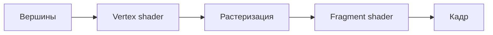

# Vulkan — конвейер рендеринга

Vulkan — низкоуровневый графический API: почти всё, что в OpenGL делал драйвер, здесь делает программист. Зато в обмен получаешь предсказуемость и скорость.

> [!info] Где это в Holotype
> Весь интерфейс Holotype рисуется через Vulkan-бэкенд `wgpu`: текст, плашки и даже формулы — это треугольники в одном проходе рендеринга.

## Основные объекты

| Объект | Зачем нужен |
|---|---|
| `VkInstance` | связь приложения с загрузчиком Vulkan |
| `VkPhysicalDevice` | видеокарта |
| `VkDevice` | логическое устройство, через него создаётся всё остальное |
| `VkQueue` | очередь, куда отправляются команды |
| `VkSwapchainKHR` | набор изображений для показа на экране |
| `VkPipeline` | состояние конвейера: шейдеры, растеризация, смешивание |
| `VkCommandBuffer` | записанные команды рисования |

## Стадии графического конвейера



1. **Input assembler** собирает вершины из буферов
2. **Vertex shader** преобразует координаты: $\mathbf{p}' = P \cdot V \cdot M \cdot \mathbf{p}$
3. **Rasterization** превращает треугольники во фрагменты
4. **Fragment shader** вычисляет цвет каждого фрагмента
5. **Color blending** смешивает результат с тем, что уже есть в кадре

> [!tip] Синхронизация
> Кадры «в полёте» разделяют семафоры (GPU↔GPU) и заборы (GPU→CPU). Обычно держат 2–3 кадра одновременно.

## Шейдер для примера

```glsl
#version 450
layout(location = 0) in vec2 inPos;
layout(location = 0) out vec4 outColor;

void main() {
    gl_Position = vec4(inPos, 0.0, 1.0);
    outColor = vec4(0.6, 0.5, 1.0, 1.0);
}
```

См. также: [[Rust — владение и заимствование]], [[Шейдеры]] (такой заметки ещё нет — щёлкни, чтобы создать).
