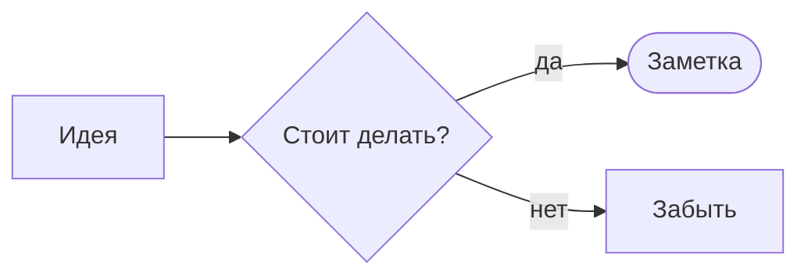

# Возможности Markdown

Здесь собраны все способы оформления, которые понимает Holotype. Открой заметку в режиме **Сплит**, чтобы видеть разметку и результат рядом.

## Текст

Обычный текст, **жирный**, *курсив*, ***жирный курсив***, ~~зачёркнутый~~, ==выделение маркером== и `код в строке`. Ссылки бывают внешние (https://www.rust-lang.org) и внутренние: [[Добро пожаловать]], [[Формулы#Матрицы|раздел про матрицы]].

Сноски тоже работают[^1].

### Цвета и бейджи

Без атрибута код в строке окрашен в акцентный цвет интерфейса, но цвет можно задать: `useState`{blue}, `готово`{green}, `ошибка`{red}, `свой цвет`{#ff8800}. Бейдж — это `Модуль 3`{badge} или цветной: `новое`{badge green}, `v2.0`{badge #ff8800}. Выделение тоже бывает разным: ==жёлтое==, ==голубое=={cyan}, ==розовое=={pink}, ==любого цвета=={#a78bfa}.

### Клавиши

Сохранить заметку — {{Ctrl+S}}, быстрый переход — {{Ctrl+O}}, поиск — {{Ctrl+Shift+F}}. Можно писать и через HTML: <kbd>Alt</kbd> + <kbd>F4</kbd>.

## Списки

1. Первый пункт
2. Второй пункт
   - вложенный маркированный
   - ещё один
     - и ещё глубже
3. Третий пункт

### Задачи

- [x] Установить Rust
- [x] Собрать Holotype
- [x] Написать первый конспект
- [ ] Связать заметки ссылками

Галочки кликабельные прямо в режиме чтения — щёлкать можно и по самому тексту задачи.

## Плашки (callouts)

> [!note] Заметка
> Обычная плашка для пояснений.

> [!info]
> Заголовок можно не писать, тогда будет стандартный.

> [!warning] Внимание
> Здесь что-то важное.

> [!danger] Опасно
> Не делай так в продакшене.

> [!success] Готово
> Всё получилось!

> [!question]- Сворачиваемая плашка (щёлкни по заголовку)
> Скрытое содержимое: ответ — **42**.

> [!example] Пример
> Внутри плашек работает всё: `код`, **жирный**, списки:
> - пункт один
> - пункт два

> [!bug] Баг
> Нашла ошибку — запиши сюда.

## Цитаты

> Простота — необходимое условие надёжности.
> — Эдсгер Дейкстра

> Лучший способ предсказать будущее — изобрести его.
> — Алан Кэй

Подпись автора — это последняя строка цитаты, начинающаяся с тире «—».

## Код

Блоку можно дать заголовок, например имя файла: ```` ```rust title="main.rs" ````.

```rust title="main.rs"
fn main() {
    let notes = vec!["Rust", "Vulkan", "egui"];
    for (i, note) in notes.iter().enumerate() {
        println!("{i}: {note}");
    }
}
```

Несколько блоков подряд с атрибутом `tab` объединяются во вкладки:

```js tab="Без React" title="like-button.js"
// Находим элементы на странице вручную
const button = document.querySelector('#like');
const counter = document.querySelector('#count');
let likes = 0;

// При каждом клике сами обновляем DOM
button.addEventListener('click', () => {
  likes = likes + 1;
  counter.textContent = likes;
  button.classList.toggle('active', likes > 0);
});
```

```jsx tab="С React" title="LikeButton.jsx"
import { useState } from 'react';

// React сам обновит DOM, когда изменится состояние
export function LikeButton() {
  const [likes, setLikes] = useState(0);
  return (
    <button className={likes > 0 ? 'active' : ''} onClick={() => setLikes(likes + 1)}>
      ♥ {likes}
    </button>
  );
}
```

Подсветка знает около 170 языков, от Python и C++ до шейдерных GLSL и WGSL:

```glsl title="circle.frag"
#version 450
layout(location = 0) in vec2 uv;
layout(location = 0) out vec4 color;

void main() {
    float d = length(uv - 0.5);
    float circle = 1.0 - smoothstep(0.24, 0.25, d);
    color = vec4(vec3(circle), 1.0);
}
```

```python
def fib(n: int) -> int:
    a, b = 0, 1
    for _ in range(n):
        a, b = b, a + b
    return a
```

## Таблицы

| Хук | Для чего нужен | Где изучаем |
|:----|:---------------|:------------:|
| `useState` | Хранит состояние компонента | `Модуль 3`{badge} |
| `useEffect` | Побочные эффекты: запросы, подписки, таймеры | `Модуль 5`{badge} |
| `useRef` | Ссылка на DOM-элемент или значение между рендерами | `Модуль 5`{badge} |
| `useContext` | Данные без передачи через props | `Модуль 5`{badge} |
| `useMemo` | Кеширует результат вычислений | `Модуль 5`{badge} |

Выравнивание колонок задаётся двоеточиями в строке-разделителе: `:---` влево, `:---:` по центру, `---:` вправо.

Отдельную ячейку можно выровнять по-своему: метка `{слева}`, `{центр}` или `{справа}` в начале ячейки важнее выравнивания колонки.

| Задача | Статус | Срок |
|:-------|:------:|-----:|
| Подсветка кода | `готово`{badge green} | октябрь |
| Диаграммы | `готово`{badge green} | октябрь |
| {справа} **Итого** | {слева} 2 из 2 | {центр} — |

## Картинки

Картинки вставляются как `![[файл.png]]` или ``. Размер можно задать так: `![[обложка.png|320]]`.

![[обложка.png|320]]

Чтобы добавить картинку, просто **перетащи файл** в окно с открытой заметкой.

## Встраивание заметок

Заметку можно встроить целиком: `![[Горячие клавиши]]`.

## Диаграммы

Блоки кода `mermaid` и `dot` превращаются в схемы. Все виды диаграмм и примеры — в заметке [[Диаграммы]].



---

[^1]: Вот так выглядит сноска. Щёлкни по номеру в тексте, чтобы перейти сюда.
