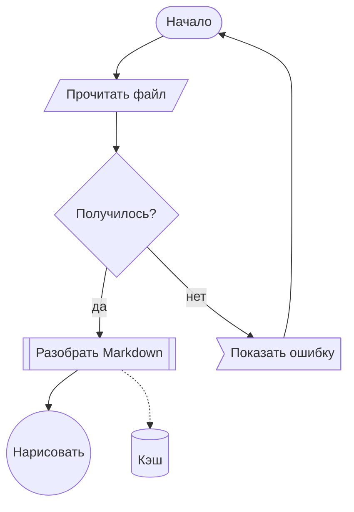
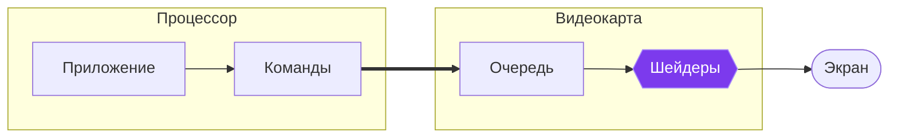
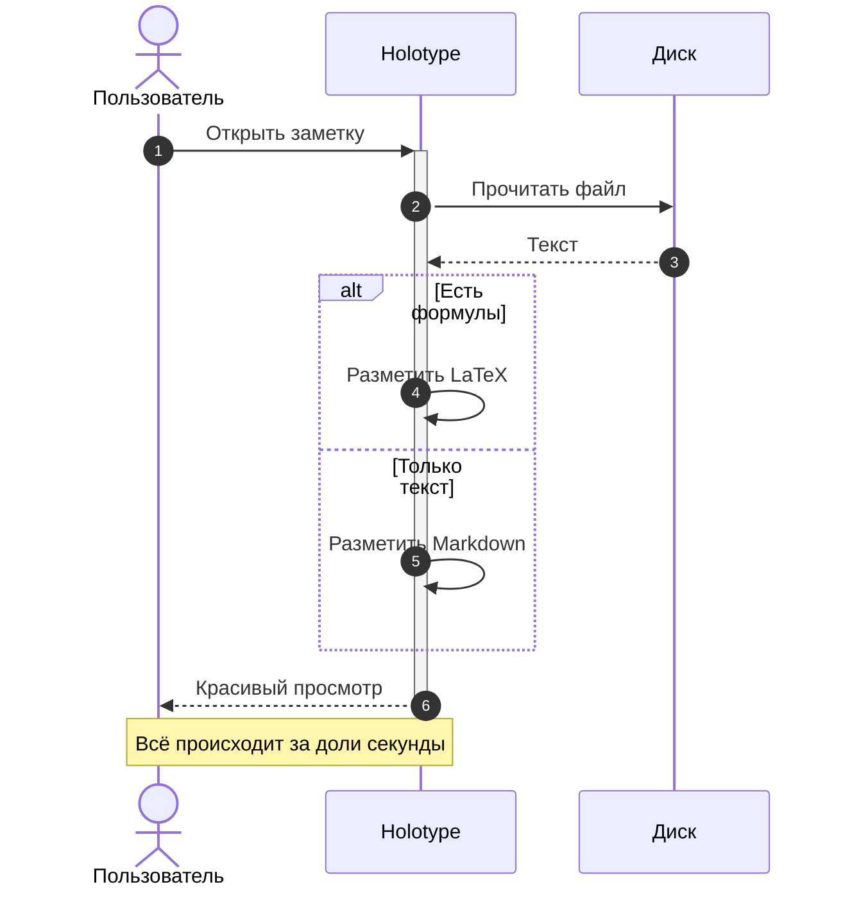
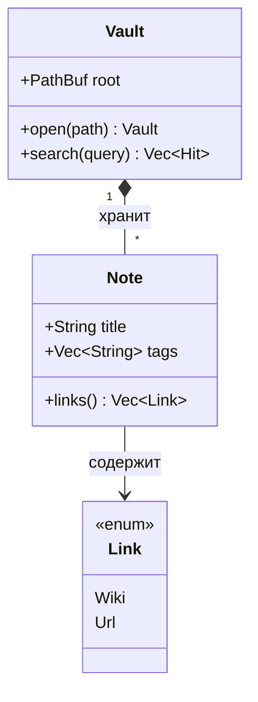
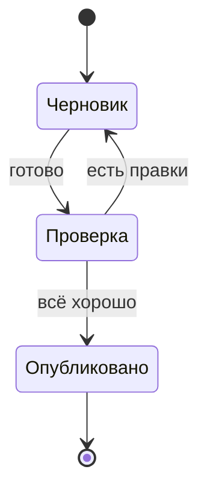
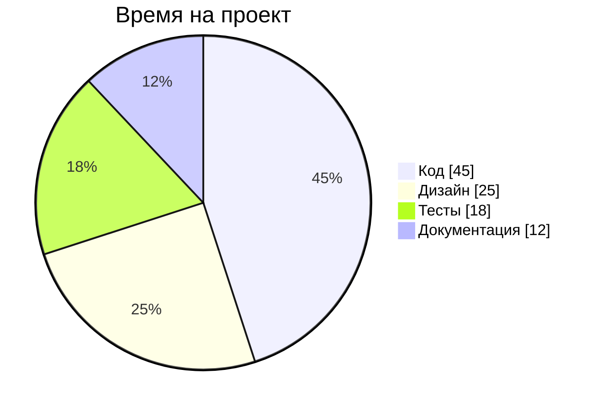
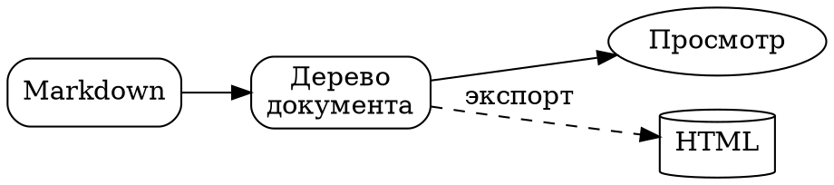

# Диаграммы

Схемы пишутся текстом прямо в заметке — в блоке кода с языком `mermaid` (или `dot` для Graphviz). В режиме чтения вместо кода появляется картинка, а кнопка **Код** в шапке блока показывает исходник. При экспорте в HTML диаграммы сохраняются как SVG.

## Блок-схема

Направление задаётся после `flowchart`: `TD` — сверху вниз, `LR` — слева направо (ещё бывают `BT` и `RL`). Фигуры узлов:

| Запись | Фигура |
|:--|:--|
| `A[текст]` | прямоугольник |
| `A(текст)` | скруглённый прямоугольник |
| `A([текст])` | «таблетка» |
| `A((текст))` | круг |
| `A{текст}` | ромб — условие |
| `A{{текст}}` | шестиугольник |
| `A[(текст)]` | цилиндр — база данных |
| `A[[текст]]` | подпрограмма |
| `A[/текст/]` | параллелограмм — ввод и вывод |
| `A>текст]` | флажок |

Стрелки: `-->` обычная, `---` без наконечника, `-.->` пунктирная, `==>` жирная, `--o` и `--x` с кружком и крестиком. Подпись пишется как `-->|текст|` или `-- текст -->`. Несколько связей можно записать цепочкой: `A --> B --> C`, а `A & B --> C` соединит сразу два узла.

### Подграфы и цвета

Цвет узла задаётся через `style Узел fill:#цвет,stroke:#цвет,color:#цвет` или классом: `classDef имя …` и `class Узел имя`.

## Последовательность

Стрелки: `->>` сплошная, `-->>` пунктирная (ответ), `-x` с крестиком, `-)` асинхронная. Плюс и минус после стрелки (`->>+`, `-->>-`) показывают, когда участник занят. Блоки `loop`, `alt`/`else`, `opt` и `par` обводят группы сообщений рамкой.

## Классы

## Состояния

## Круговая диаграмма

## Graphviz

Для блоков `dot` понимается основной синтаксис Graphviz:

> [!tip] Что поддерживается
> Блок-схемы, последовательности, классы, состояния и круговые диаграммы mermaid, а также Graphviz. Для остальных типов (например, `gantt`) Holotype покажет исходный код.
